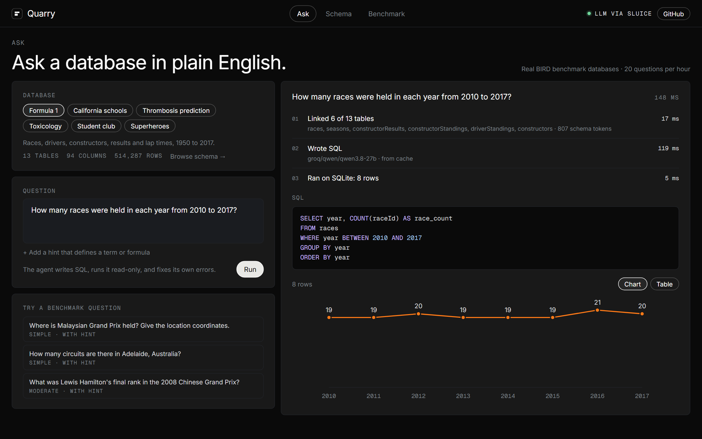
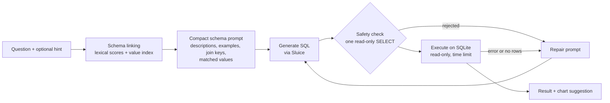
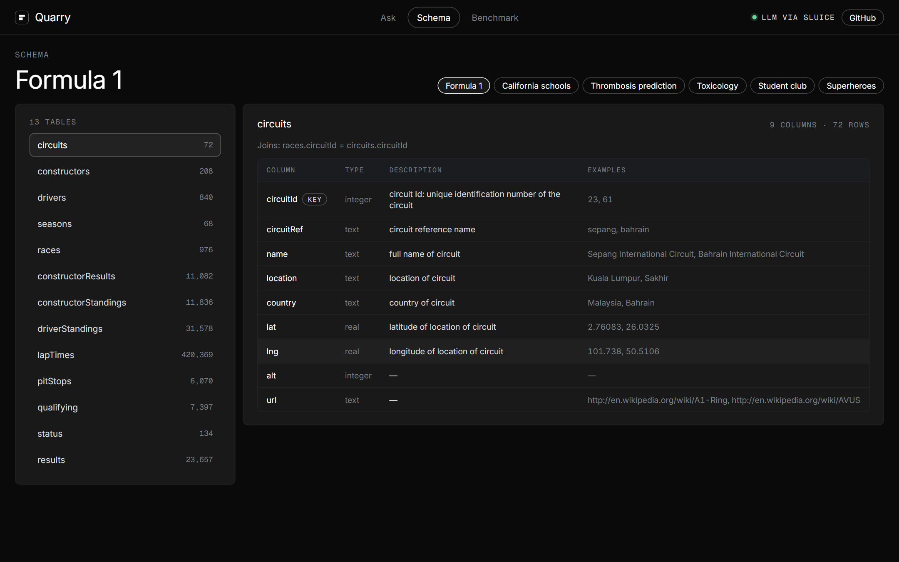
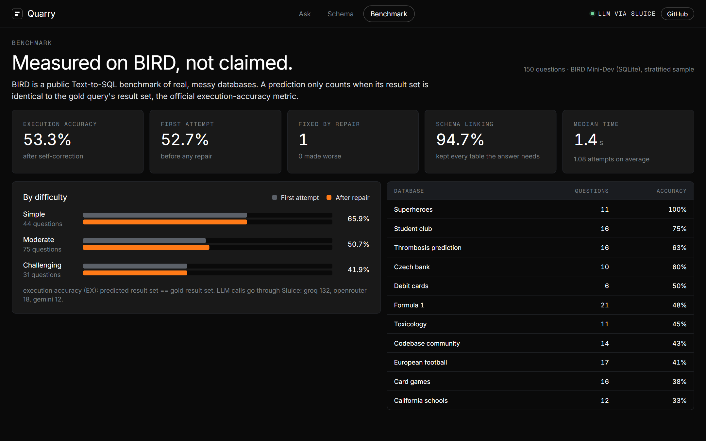

<p align="center">
  
</p>

<p align="center">
  <a href="https://quarry-inky.vercel.app"></a>
</p>

<p align="center">
  
  
  
  
  
  
</p>

# Quarry

**Text-to-SQL with Schema Linking and Execution-Guided Repair.** Ask a question about a real database in plain English; Quarry finds the tables, columns and stored values the question refers to, writes a single SQLite query, runs it read-only with a time limit, rewrites it if SQLite reports an error or finds nothing, and returns the result as a table or chart. It is evaluated on [BIRD](https://bird-bench.github.io/), the standard benchmark of large, messy, real-world databases.

**Live demo: https://quarry-inky.vercel.app** · six BIRD databases, from Formula 1 results to hospital lab records.

<p align="center">
  <a href="https://quarry-inky.vercel.app"></a>
</p>

## Results

150 questions from [BIRD Mini-Dev](https://huggingface.co/datasets/birdsql/bird_mini_dev) (SQLite), sampled with the official difficulty mix and scored with BIRD's execution-accuracy metric: a prediction counts only when its result set is *identical* to the gold query's. Reproduce with [`bench/eval_bird.py`](bench/eval_bird.py); every prediction is in [`bench/results/`](bench/results).

| | Questions | Execution accuracy |
|---|---|---|
| Simple | 44 | 65.9% |
| Moderate | 75 | 50.7% |
| Challenging | 31 | 41.9% |
| **All** | **150** | **53.3%** (±8.0 at 95%) |

- **Models:** free open-weight models only (gpt-oss-120b and Qwen3 on Groq, Gemini Flash, Nemotron on OpenRouter), reached through [Sluice](https://github.com/rohithprem18/sluice), which routes and fails over between them.
- **Schema linking** kept every table the gold SQL needs for **94.7%** of questions, while sending about 1,200 tokens of schema on average (the largest database has 199 columns).
- **Speed:** median 1.4 s per question end to end.

For context, BIRD's published Mini-Dev leaderboard (all 500 questions, SQLite) lists GPT-4 at 47.8%, GPT-4 Turbo at 45.8%, Llama-3-70B-Instruct at 40.8% and the TA-SQL pipeline with GPT-4o at 63.0%. Quarry's figure comes from a 150-question sample, so treat the comparison as indicative, not a leaderboard entry.

**What the numbers say about self-correction.** Execution-guided repair fixed exactly one question. Nearly every wrong answer was valid SQL that ran and returned rows, but answered a subtly different question (a different aggregation, a missing filter, an extra column). Error-driven repair cannot catch those; the next accuracy gains would come from better linking and candidate selection, not more retries.

## How it works



**Schema linking.** Every column is scored against the question and the hint: word overlap with its name, BIRD's column description and sample values; a bonus when the hint names it; and a larger bonus when one of its *stored values* appears in the question. That last signal comes from a full-text index of each database's distinct short text values, built offline, so "customers who pay in CZK" links to `customers.Currency = 'CZK'` with the exact stored spelling. The best tables are kept, bridge tables are added so they can be joined, and wide tables are trimmed to their most relevant columns plus keys. On all 500 Mini-Dev questions this keeps every needed table 96.6% of the time and finds 81% of the literals users type, in about 6 ms with no model call.

**Generation and repair.** The prompt contains only the linked schema (with descriptions, example values and join keys), the matched values and the hint. The model returns one query. If SQLite reports an error, or the first attempt returns no rows, the error or a "check your filters" note goes back to the model for another attempt, at most twice; if the model returns the same query again, Quarry accepts it.

**Safety.** Output is parsed with [sqlglot](https://github.com/tobymao/sqlglot): exactly one `SELECT`/`WITH` statement, no `PRAGMA`, `ATTACH` or writes. The database is opened `mode=ro&immutable=1` with `query_only` on, and a progress handler aborts anything that exceeds the time limit.

## Console

| | |
|---|---|
|  |  |
| **Ask:** live trace (linking, SQL, execution, repairs), highlighted SQL and an automatic chart | **Schema:** every table and column with BIRD's descriptions, examples and join keys |
|  | |
| **Benchmark:** execution accuracy by difficulty and database | |

## Run locally

```bash
git clone https://github.com/rohithprem18/quarry.git && cd quarry
python -m venv .venv && source .venv/bin/activate     # Windows: .venv\Scripts\activate
pip install -r requirements-dev.txt
python -m quarry.prep --download                      # BIRD dev set (346 MB) -> data/dbs
cp .env.example .env                                  # set QUARRY_LLM_API_KEY (a Sluice key, or any OpenAI-compatible endpoint)
set -a && . ./.env && set +a
uvicorn quarry.app:app --port 8000
cd web && npm ci && npm run dev                       # console on http://localhost:5176
```

Any OpenAI-compatible endpoint works, for example Groq directly: `QUARRY_LLM_BASE_URL=https://api.groq.com/openai/v1`, `QUARRY_LLM_MODEL=openai/gpt-oss-120b`.

Run the benchmark: `python bench/eval_bird.py --n 150` (resumable; `--summarize` rebuilds the summary).

## Deploy (free)

The six demo databases (about 64 MB with their indexes) ship inside one Vercel Python function; the console is static. `npx vercel link`, add `QUARRY_LLM_API_KEY` (and optionally Upstash Redis for shared rate limits) with `npx vercel env add`, then `npx vercel deploy --prod`. See [`vercel.json`](vercel.json).

## Project layout

```
quarry/
├── quarry/
│   ├── prep.py        # BIRD download, schema.json + value index per database
│   ├── linking.py     # column/table scoring, value matching, bridge tables, prompt schema
│   ├── agent.py       # generate → check → execute → repair loop, streamed as events
│   ├── sqlsafe.py     # SQL extraction and read-only validation (sqlglot)
│   ├── executor.py    # read-only SQLite with a time limit
│   ├── charts.py      # stat / bar / line / table suggestion
│   ├── llm.py         # OpenAI-compatible client (Sluice by default)
│   ├── catalog.py     # databases and their metadata
│   └── app.py         # FastAPI: databases, schema, streaming /api/ask, benchmark
├── bench/             # BIRD Mini-Dev evaluation + every prediction
├── web/               # React + Vite console
└── tests/             # 27 tests on a self-contained database with a scripted model
```

## Limitations

- Scores come from a 150-question sample; the full 500 would tighten the ±8-point interval.
- Free-tier rate limits occasionally leave no provider available (one benchmark question failed that way).
- BIRD's hints ("evidence") are part of the benchmark input. Without a hint, questions that depend on domain definitions are harder, as they would be for a new analyst.

## Data

BIRD databases and questions are © their authors, released under [CC BY-SA 4.0](https://creativecommons.org/licenses/by-sa/4.0/); they are downloaded at setup time and not stored in this repository.

## License

MIT
